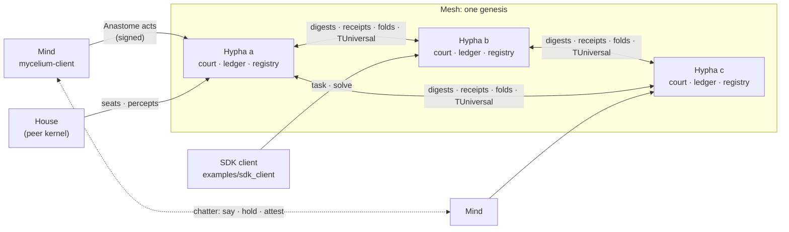

# Mycelium

**Version 0.1.1** · [Quick start](#quick-start) · [Glossary](GLOSSARY.md) · [Equations](docs/EQUATIONS.md) · [Changelog](CHANGELOG.md) · [Contributing](CONTRIBUTING.md) · [License: Apache-2.0](LICENSE)

Mycelium is a distributed mesh network for **POW++**, a family of proofs of
work in which the work proven is verified computation. The network's nodes
are **hyphae** (courts), which adjudicate, settle and keep the ledger, and
**minds** (clients), which perceive tasks, learn a shared language and
submit work for adjudication. Every quantity the protocol decides on is
computed exactly, in the conformal geometric algebra Cl(4,1) over the
rationals ℚ, with no floating point anywhere.

The project is open for collaboration. This release gives contributors:
- a running network: courts, clients, the wire protocol and the
  settlement rules;
- a client SDK with a complete example;
- the specifications the implementation is held to.

[CONTRIBUTING.md](CONTRIBUTING.md) describes how to take part.

Provenance: the source and documentation were generated by AI systems under
the author's direction ([`DISCLAIMER.md`](DISCLAIMER.md)).

---

## Quick start

To run a three-hypha network and an SDK client on one machine:

```sh
git clone https://github.com/SAIOS-SAMN/mycelium && cd mycelium
git clone --depth 1 https://github.com/arcprize/ARC-AGI-2 ../ARC-AGI-2
mkdir -p data && ln -s "$(cd ../ARC-AGI-2/data && pwd)" data/arc-agi-2
scripts/quickstart
```

`scripts/quickstart` runs these steps:
1. Builds the release binaries if they are absent.
2. Creates a key for every node.
3. Writes the genesis allocation and each hypha's address and peers.
4. Signs a 30-task corpus.
5. Starts three hyphae (ports 7700–7702): the first mints the genesis and
   the other two adopt it.
6. Runs the SDK client against them. The client asks for tasks, states
   rules, and receives the courts' verdicts and payments.

The network keeps running, and the script prints the commands for reading
it, until Ctrl-C. `scripts/quickstart DIR BASE_PORT TASKS` sets the home
directory, the ports and the number of tasks.

---

## Contents

- [Quick start](#quick-start)
- [Architecture](#architecture)
- [POW++: the proofs of work](#pow-the-proofs-of-work)
- [The unit of value: μ](#the-unit-of-value-μ)
- [Adjudication](#adjudication)
- [The workload](#the-workload)
- [Repository layout](#repository-layout)
- [Building and testing](#building-and-testing)
- [Running a node](#running-a-node)
- [Building a client with the SDK](#building-a-client-with-the-sdk)
- [Developing with us](#developing-with-us)
- [Versioning](#versioning)
- [Documentation](#documentation) · [Glossary](GLOSSARY.md) · [Equations](docs/EQUATIONS.md)
- [License](#license)

---

## Architecture

| Component | Binary | Role |
|---|---|---|
| **Hypha** (court) | `mycelium-server` | Admits signed acts, replays submitted work, rules on it, settles payments, keeps a hash-chained receipt ledger, folds the ledger into eras, and exchanges digests and co-signatures with peer hyphae. |
| **Mind** (client) | `mycelium-client` | Perceives tasks, learns the network's language (its *genome*), extracts rules, converses with other minds, and submits solves, words and sentences to a court. A mind can hold a *seat* in a house run by another kernel. |
| **Soak harness** | `mycelium-soak` | Long-running load and durability runs against a mesh. |
| **Law forms** | `forms/` (crate) | The exact law forms shared with the other kernels that join the mesh, depending only on exact rationals. |



One unit of useful work, from task to payment:

```mermaid
sequenceDiagram
    participant V as Client (voice key)
    participant H as Hypha (court)
    participant W as Peer hypha (witness)
    V->>H: ACT_TASK (voice)
    H-->>V: task envelope (train pairs, test inputs)
    Note over V: extract rule · mint element · speak on tests
    V->>H: ACT_SOLVE (outputs, rule tape, signature)
    Note over H: replay the rule on withheld pairs
    H-->>V: verdict: BOUNTY + μ paid · FLOOR · NOTHING (named refusal) · UNREAD
    H->>W: offer (re-derive the vertex)
    W-->>H: same vertex: second vantage, install
    Note over H,W: POUW minted; shares to cited forms, taught words, voices
```

**Wire.** Nodes speak **Anastome** (`src/anastome/`), a closed set of
signed speech acts whose payloads are exact geometric objects: canonical
elements, coboundary chains and four-lane μ vectors. The protocol defines
about forty act kinds, among them percept, task, solve, speech, docket,
settle, offer, fold, fetch, syllabus, seat, handoff and challenge. Payloads
carry no natural-language text.

**Language.** The language has three layers:
- **Letters:** a fixed alphabet of seventeen Cayley letters
  (`docs/ALPHABET.md`).
- **Words:** products of letters. A word is a vertex whose meaning is its
  versor.
- **Sentences:** forms built from words: vertices, faces and rings, glued
  along shared overlaps.

A rule a mind states about a task is a sentence. That sentence carries
geometric **rule elements** (`src/transducer/sentence/form/rule_element.rs`):
- a *carriage*: a versor of Cl(4,1)(ℚ) applied once or iterated to a
  contact, with a gauge (hue) map;
- 2-chains bounded by a selection;
- 1-chains joining bodies;
- frame operations.

Elements with an English name are glossed as clauses, such as *slide*,
*fill* or *echo*. The element is what travels on the wire; the clause is
its translation.

**Clock.** Network time is **TUniversal**, a point `{origin, h, S:G:T:H, K}`
that is final once a majority of keepers hold it. Consensus uses no wall
clock (`src/chronometry/`).

**Ledger.** Each hypha keeps its acts on a receipt chain. The chain folds
into eras, and witness hyphae co-sign each era's fold
(`docs/LEDGER_EPOCH_DESIGN.md`).

---

## POW++: the proofs of work

POW++ is a *family* of proofs. Each member is a distinct act with its own
settlement row on the ledger, and the members are never summed across
(`docs/MU-ECONOMY.md` §0; `src/economy/treasury.rs`, `enum Arm`). Every
payment row names the arm it pays. Rows that prove no work carry no arm:
genesis, stake, escrow, revocation, slash, burn, fee and subsidy.

| Arm | Name | The act that is proven | What settlement does | Code |
|---|---|---|---|---|
| **POUW** | Proof of useful work | A listed demand is **closed**. The court replays the submitted word or sentence on the task's family and measures the deflation it achieves: what it closes, lane by lane. | **Mints** the measured deflation and pays it to the closer. | `economy/escrow.rs`, `economy/settle.rs`, `server/cognition/court/install.rs` |
| **POWC** | Proof of work convergence | A demand one mind could not discharge is **closed at another perspective**: another mind's work, citing the first mind's receipt, discharges it. A word discovered by one mind and used by a later demand is the same relation. | **Mints** the citation's measured discharge to the closer (`settle_convergence`), and pays the cited discoverer by **transfer** from the user of the word (`settle_use`). | `economy/settle.rs` |
| **POWR** | Proof of work retirement | A word or form is **re-expressed over fewer letters**, by retirement along a geodesic or by citation; a refinement bid is replayed with the retired word excluded. | **Burns** the freed description and pays the retirer the compression yield. | `economy/settle.rs` (`settle_rewrite`), `server/cognition/book/rewrite.rs` |

### How POUW is divided on install

When a court installs a sentence on a second vantage (see
[Adjudication](#adjudication)), the POUW mint is divided according to the
local discharge each contribution achieves on the sentence's own task
family (`docs/MU-CLIENT.md` §5.4 and §5.6). It goes in this order:

1. **Cited forms:** each closed form the sentence glues in takes its own
   local discharge on the citing sentence's family.
2. **Taught words (D2′):** words the sentence's closed rings teach. A word
   already held pays its discoverer a use share. A new word is installed on
   its own act, and its speaker takes the base share.
3. **Composition premium / gluing (S):** what the sentence closes beyond
   the sections of its words goes to the sentence's voices.

Two further entries are recorded alongside these shares:

- **Attestations (E3):** a mind that verifiably agreed with a word becomes
  a party to its claim.
- **Convergence:** two minds whose words are different vertices but have
  the same section on one scene are each sealed as an attestation on the
  other's word.

A demand closed by another mind is paid as POWC (E2).

### Named refusals

Every refusal a court issues names its cause, for example `REFUSE_EDGE`,
`REFUSE_RULE_TIE` or `REFUSE_MV_INEXACT`. A refusal is information that
refines the asker's model. The obstruction calculus (OB1–OB5) is specified
in `docs/MU-RECURSION.md`.

---

## The unit of value: μ

μ is the currency, and it is a four-lane vector, not a scalar:

| Lane | Meaning |
|---|---|
| **S** (spatial) | boosts and dilations |
| **G** (gauge) | hue cycles and moves |
| **T** (temporal) | null flux |
| **H** (holonomic) | turns |

A payment moves value on exactly the lanes the verified work moved. Lanes
never convert, and a comparison of two μ vectors returns a per-lane reading
(`docs/MU-ECONOMY.md` §1). The same rule holds throughout the codebase: no
norm or sum collapses μ, a geometric quantity, or a reading to a single
number.

---

## Adjudication

- **Second vantage (47.3):** a word or sentence is installed when two
  independent hyphae re-derive the *same vertex*. Equality is algebraic
  (`same_vertex`, projective equality of versors), never byte equality of
  encodings. Disagreeing re-derivations are refused as inconsistent data,
  never settled by a vote (`src/court/convergence.rs`).
- **Verdicts by replay:** solves are judged by replaying the submitted rule
  on pairs the submitter never saw (`src/court/verdict/`). A rule that
  states geometric elements is spoken on each scene and must reproduce the
  expected output exactly.
- **Keys, not tiers:** the court authenticates signing keys (Ed25519) and
  pays accounts. Access policy belongs to the kernel that runs a house
  (`docs/CONCORDANCE.md`).

---

## The workload

The useful work is drawn from the **ARC-AGI-2** corpus: grid-transformation
tasks with training pairs and withheld test pairs. A mind's solve counts as
useful work when the court's replay of the mind's rule reproduces the
withheld outputs. The corpus is obtained separately (see
[Building and testing](#building-and-testing)).

---

## Repository layout

```
src/
  anastome/     wire protocol: signed speech acts and their codecs
  arc.rs        task grid types and the corpus location
  bin/          mycelium-server, mycelium-client, mycelium-soak
  chronometry/  receipt chain, TUniversal clock, keepers
  client/       the mind: perception, winding, conversation, seats (sdk/)
  core/         exact arithmetic foundations
  court/        admission, convergence (47.3), verdicts and replay
  economy/      treasury, escrow, settlement (POUW / POWC / POWR)
  network/      mesh record, nerve, keyed carriers
  observe/      typed readings
  physics/      metabolism: budgets, reserves, lane pressure
  server/       the hypha's cognition: books, listings, install, market
  transducer/   the algebra: Cl(4,1)(ℚ), alphabet, elements, sentences,
                perception of grids (family/), rule elements
  voice/        voice identity and signing
examples/       sdk_client.rs (a complete client), durable_drill.rs
forms/          shared exact law forms (separate crate)
xtask/          the gate: source-length bound and clippy with -D warnings
ops/            systemd unit templates
scripts/        operational helpers (observer, readings, durability drill)
tests/          integration tests
docs/           design specifications
```

---

## Building and testing

Rust 1.82 or later (developed on 1.95) on Linux.

```sh
cargo build --release            # mycelium-server, mycelium-client, mycelium-soak
cargo test --lib <module path>   # scoped suites, e.g. transducer::family::tests::elements
(cd xtask && cargo run)          # the gate: reading bound, then clippy -D warnings on every target
```

Test suites are run by module path. Some suites replay corpus tasks.

**Corpus.** The ARC-AGI-2 dataset from the ARC Prize Foundation is read at
`data/arc-agi-2/{training,evaluation}/*.json` relative to the repository
root, or under the directory named by `MYCELIUM_CORPUS`.

**Lints.** The crate denies `unsafe_code`, float arithmetic, lossy casts,
and `unwrap`/`expect`/`panic` outside tests. It also enforces a set of
disallowed types and methods (`clippy.toml`). The coding standards are in
[`docs/MU-STANDARDS.md`](docs/MU-STANDARDS.md).

---

## Running a node

A node is a **hypha**: one `mycelium-server` process with its own home
directory, holding the court, the ledger and a task registry. A network is
a set of hyphae that share one **genesis**. The genesis is the chain hash
of the network's first receipt, written once by one hypha and adopted by
every other.

### What a home holds

| File | Written by | Content |
|---|---|---|
| `hypha.key` | `--init` | The node's Ed25519 seed (32 bytes); its verifying key is the node's identity. |
| `bind`, `peers`, `genesis` | the operator, before the first boot | Provisioning, read on the first boot. |
| `mesh` | the node | The signed mesh record: bind, peers, genesis allocation, adopted origin, epoch. The node builds it from the provisioning files on the first boot. |
| `corpora/*.manifest` | `--sign-corpus` | A signed task corpus the court registers. |
| `ledger`, `line`, `eras`, `keeper/` | the node | The court's state: language, receipt chain, ledger eras, TUniversal keeper record. |

### Bringing up a network

The procedure below was run end to end with three hyphae and an SDK
client. The client was paid for the tasks it solved on the resulting
network.

**1. Create an identity for every node.**

```sh
mycelium-server --home /srv/myc/a --init     # prints:  genesis line: hypha <vk hex>
mycelium-server --home /srv/myc/b --init
mycelium-server --home /srv/myc/c --init
mycelium-client --home /srv/myc/v1 --init    # prints:  genesis line: voice <vk hex> <S> <G> <T> <H>
```

**2. Write the genesis allocation.** Collect the printed lines into one
`genesis` file:
- one `hypha <vk>` line for each court of the network;
- one `voice <vk> S G T H` line for each client funded at genesis. The four
  numbers are its μ allocation on the S, G, T and H lanes.

Place the same file in every hypha's home. Every court bonds the hyphae
named here, and each of them is an independent witness
([Adjudication](#adjudication)).

```text
hypha 44b00dee3eab19b73ca5f56bcc7ed4c45070fc2ae1dc2f4c319b0491888074d1
hypha be643e831919d4eb8a9053d9eaa34aa2c77f85790f5b23135ff344fe93a0e75e
hypha 5d10d3876c47bb51da7e2b6db7fda03f20f7b28835145dbe3810461a2fb0c7ff
voice 1eac4511991e6918a46c8ab7494149a1178079fa62d4588ade049922948eb7bb 8 8 1 8
```

**3. Give each hypha its address and peers.**
- `bind`: one line with the address the hypha serves on.
- `peers`: the other hyphae's addresses, one per line.

```sh
echo 127.0.0.1:7610 > /srv/myc/a/bind
printf '127.0.0.1:7611\n127.0.0.1:7612\n' > /srv/myc/a/peers
# likewise for b and c
```

**4. Register a task corpus.** A hypha named in the genesis signs the
corpus. Its manifest is then copied to every hypha, and each court
registers any corpus whose manifest a genesis hypha signed. The manifest
names the corpus directory by its absolute path, so that directory must
exist at the same path on every host.

```sh
mycelium-server --home /srv/myc/a --sign-corpus /srv/corpus/arc-agi-2/training
cp /srv/myc/a/corpora/training.manifest /srv/myc/b/corpora/
cp /srv/myc/a/corpora/training.manifest /srv/myc/c/corpora/
```

**5. Start the network.** One hypha mints the genesis on its first start.
The others adopt it from a peer.

```sh
mycelium-server --home /srv/myc/a --mint-genesis   # logs: court genesis <hash>… epoch 0 written
mycelium-server --home /srv/myc/b
mycelium-server --home /srv/myc/c
```

Every later start, including a's, omits `--mint-genesis`.

**6. Verify.**

```sh
mycelium-server --home /srv/myc/b --check   # mesh: …, peers 2, genesis ef0a…, epoch 0 — this home will boot
mycelium-server --home /srv/myc/a --console --reading court
```

`--check` reads a home without starting it: the key, the mesh record and
its adopted genesis, the ledger, and whether the home boots on this build.
It exits 0 if the home will boot and 3 if it will not.

### Joining a network

A hypha joins a network by being named in the network's genesis
allocation. Run steps 1–3 with the network's `genesis` file and its hyphae
as `peers`, copy the corpus manifests (step 4), and start without
`--mint-genesis`. The node adopts the network's genesis from its peers.

### Operating a node

- **Readings.** `mycelium-server --home DIR --console --reading <name>`
  prints a typed reading: `acts`, `court`, `economy`, `judged`,
  `dispatched`, `clock`, `memory`, `replication`, `agreements` and others.
  `--at HOST:PORT` reads another hypha.
- **Restarts** persist the ledger on SIGINT, SIGTERM and SIGHUP. `--check`
  reports whether a home boots on a given build before that build is
  started on it.
- **Recut.** `scripts/recut` re-founds a network on a fresh genesis. A recut
  is the procedure for adopting a new ledger layout, and it starts court
  state afresh.
- **systemd.** `ops/mycelium-{server,client}@.service` are user-unit
  templates; set the checkout path in them.

### Node capabilities in 0.1.1

| Capability | Verified |
|---|---|
| Node identity (`--init`), provisioning, signed mesh record | end to end |
| Genesis minted by one hypha and adopted by its peers | end to end |
| Peer exchange: digests, receipts, ledger eras, co-signed folds | on one host |
| Corpus signing (`--sign-corpus`) and registration | end to end |
| Task dispatch, solve adjudication by replay, payment | end to end, with the SDK client |
| `--check` preflight and typed console readings | in use |
| Hyphae connecting after genesis: digest exchange and receipt admission | in code; post-genesis bonding is an active design area |
| Transport: Ed25519-signed acts over TCP | on one host; multi-host deployment is an active area |

---

## Building a client with the SDK

A client is any program that holds a voice key and speaks Anastome acts to
a hypha. The SDK is the `mycelium` library crate's `sdk` module, together
with the wire codecs in `anastome::dialogue` and the rule machinery in
`transducer`. The reference mind (`mycelium-client`) is one client built
on it. [`examples/sdk_client.rs`](examples/sdk_client.rs) is a complete
client of about 150 lines.

### Dependency

```toml
[dependencies]
mycelium = { git = "https://github.com/SAIOS-SAMN/mycelium", tag = "v0.1.1" }
ed25519-dalek = "2.1"
```

### The client loop

```rust
use mycelium::anastome::dialogue;
use mycelium::court::identity::HyphaKey;
use mycelium::sdk::{Kernel, Session};
use mycelium::transducer::family::{extract_rule, mint_sentence_why, speak::speak_rule, NoCrystal};

// 1. Identity: a voice key, minted once and kept (32-byte Ed25519 seed).
let key = HyphaKey::load_or_mint("voice.key");
// 2. Session: one hypha's address.
let session = Session::open("127.0.0.1:7610", Kernel::from_key(key.sk.clone()));
// 3. Work: the task envelope carries train pairs and test inputs; the test
//    outputs stay with the court. An empty reply means no work is available.
let reply = session.speak(dialogue::encode_task_request(&key.vk_bytes()))?;
let task = dialogue::decode_task_envelope(&reply).ok_or("no task")?;
// 4. Rule: extracted from the train pairs, minted as an element the court
//    can replay, and spoken on each test input.
let mut budget = mycelium::physics::Physics::default().stroke_n(1 << 20);
let rule = extract_rule(&task.train, &mut budget).ok_or("no rule")?;
let element = mint_sentence_why(&rule, &task.train, &NoCrystal, 0)?;
let outputs: Vec<_> = task.tests.iter()
    .map(|x| speak_rule(&rule, x, &NoCrystal).and_then(|s| s.grid()))
    .collect::<Option<_>>().ok_or("rule does not speak a test")?;
// 5. Solve: the outputs and the rule's tape, signed by the voice the court pays.
let solve = dialogue::encode_solve_with_rule(&key.sk, &task.id, &outputs,
                                             Some(&element.to_bytes().ok_or("tape")?)).ok_or("solve")?;
let verdict = session.speak(solve)?;
let (code, paid_mu, refusal, _modes) = dialogue::decode_solve_verdict(&verdict).ok_or("verdict")?;
```

The verdict codes are:

| Code | Meaning |
|---|---|
| `SOLVE_BOUNTY` | The task's first verified closure; `paid_mu` is the payment. |
| `SOLVE_FLOOR` | A verified re-solve of a closed task. |
| `SOLVE_NOTHING` | A final verdict; `refusal` names the reason (e.g. "form leaves a remainder on the family"). |
| `SOLVE_UNREAD` | The replay is in progress; sending the same solve again resumes it. |

Running the example against a hypha:

```sh
cargo build --release --example sdk_client
target/release/examples/sdk_client /srv/myc/v1 127.0.0.1:7610 8
#   voice 1eac4511…
#   task 65b0c3689cfe3a37… solved: first verified closure (bounty) — paid μ [0, 24, 0, 0]
#   task d9144a4bc81fd016… solved: first verified closure (bounty) — paid μ [88, 0, 0, 92]
#   task da0dfd765fbe3521… not solved (final) — refused: form leaves a remainder on the family
```

### Stating your own rules

The SDK states rules in three ways, and the court replays each on withheld
pairs:
- **The bundled extractor**, `transducer::family::extract_rule`, reads a
  rule off a task's train pairs.
- **Typed steps:** `sdk::rule::sentence(&[Step], family, crystal)` mints a
  rule from steps (select, create, crop, D4 symmetries, hue moves).
- **Rule elements:** `transducer::sentence::form::rule_element` states a
  rule directly as carriages, chains, joins and frames on a `Form`.

### SDK surfaces in 0.1.1

| Surface | API | Verified |
|---|---|---|
| Identity, session, task, solve, verdict | `sdk::{Kernel, Session}`, `anastome::dialogue` | end to end (`examples/sdk_client.rs`) |
| Rule extraction, minting, speaking | `transducer::family::{extract_rule, mint_sentence_why, speak::speak_rule}` | end to end |
| Rules from typed steps | `sdk::rule::sentence` | test suite |
| Seats in another kernel's house | `sdk::seat`, `sdk::seat_mind` | in use by peer kernels; specified in `docs/MU-CLIENT.md` §6 |
| Mind-to-mind conversation | `sdk::chatter` | in use by the reference mind |

---

## Developing with us

Mycelium is developed in the open, and contributions are welcome at every
layer: the algebra, the courts, the economy, the SDK, the reference mind,
and the specifications. [CONTRIBUTING.md](CONTRIBUTING.md) covers the
workflow, the standards and the gate.

Active areas of development:

- **Rule coverage.** The act reader states rules for a share of the
  ARC-AGI-2 training corpus, and rule elements open the language beyond
  the English-named acts. New element readers extend what minds can say.
- **Network membership.** Bonding hyphae that join after genesis.
- **Deployment.** Multi-host and wide-area operation of the mesh.
- **Convergence.** Convergence of different-geometry words as admission
  evidence (`docs/MU-CLIENT.md` §5.5).
- **SDK.** A stable, versioned client surface narrower than the crate's
  public API.

Design discussion is anchored in the specifications. Section and ruling
numbers (for example *78.143* or *§5.6*) cite `docs/MU-RECURSION.md` and
`docs/MU-CLIENT.md` throughout the code.

---

## Versioning

The release version is recorded in [`VERSION`](VERSION), in the crate
manifest (`Cargo.toml`), and as a git tag (`v0.1.1`).
[`CHANGELOG.md`](CHANGELOG.md) lists what each release contains. Releases
follow semantic versioning. In the 0.x series, a minor version may change
the wire and ledger layouts, and the changelog names each such change.

---

## Documentation

| Document | Subject |
|---|---|
| [`GLOSSARY.md`](GLOSSARY.md) | The terms of the code and the specifications, defined. |
| [`docs/EQUATIONS.md`](docs/EQUATIONS.md) | Every equation, formula and master equation in use, with its specification section and code location. |
| [`docs/MU-RECURSION.md`](docs/MU-RECURSION.md) | The governing specification: the language, the algebra, the laws and every ruling, numbered. |
| [`docs/MU-CLIENT.md`](docs/MU-CLIENT.md) | The mind: perception, comprehension, conversation, the winding carrier, and how minds are paid (§5.4–§5.6). |
| [`docs/MU-ECONOMY.md`](docs/MU-ECONOMY.md) | μ, the POW++ arms, carriers, escrow, settlement and audit. |
| [`docs/CONCORDANCE.md`](docs/CONCORDANCE.md) | The agreement every kernel signs to join the mesh. |
| [`docs/MU-STANDARDS.md`](docs/MU-STANDARDS.md) | Development standards: bounds, gates, tests as algebraic claims. |
| [`docs/MU-ENGINEERING.md`](docs/MU-ENGINEERING.md), [`docs/MU-PRODUCT.md`](docs/MU-PRODUCT.md) | The system as built, and its product surfaces. |
| [`docs/XSEPTUM.md`](docs/XSEPTUM.md) | Settlement protocol for payments through a hypha. |
| [`docs/ALPHABET.md`](docs/ALPHABET.md), [`docs/MU-LEXICON.md`](docs/MU-LEXICON.md) | The alphabet; the shared vocabulary. |
| [`docs/LEDGER_EPOCH_DESIGN.md`](docs/LEDGER_EPOCH_DESIGN.md) | Ledger eras and folds. |
| [`docs/ANTI_FLATTENING_LAW.md`](docs/ANTI_FLATTENING_LAW.md) | Structure is never flattened to scalars or flat maps. |
| [`docs/MU-RECURSION-TASKS.md`](docs/MU-RECURSION-TASKS.md) | The task ledger: the roadmap against the specification. |
| [`docs/proposals/`](docs/proposals/) | Design proposals. |

---

## License

Licensed under the [Apache License, Version 2.0](LICENSE).

Copyright 2026 Daniel Edward McFarland. The source and documentation were
generated by AI systems under the author's direction; see
[`DISCLAIMER.md`](DISCLAIMER.md).
